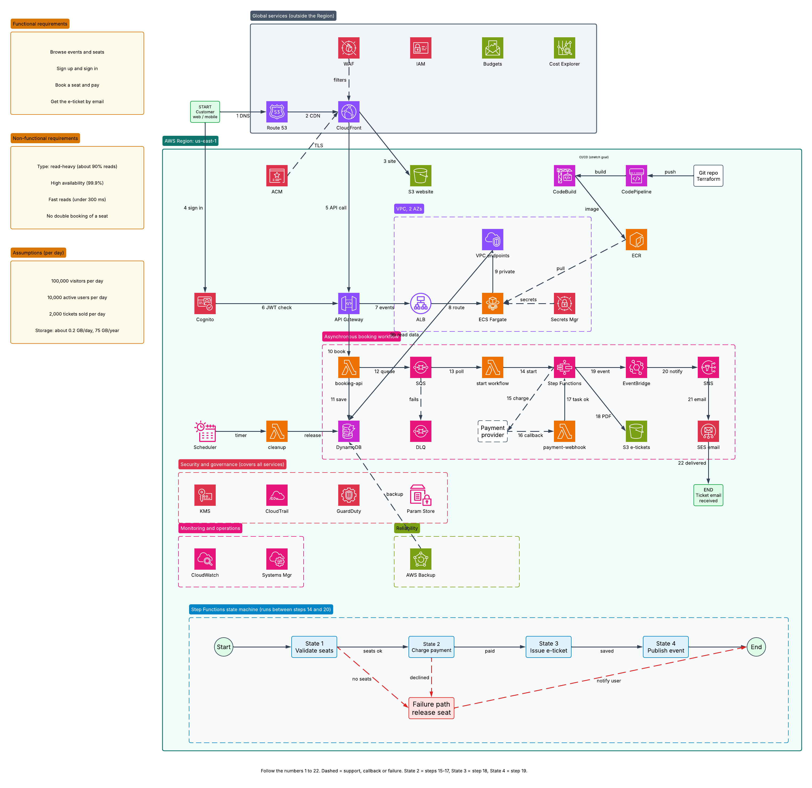

# E-Ticketing Platform on AWS

A serverless-first ticket booking platform. Customers browse events, sign in, book a seat, pay, and receive an e-ticket by email. The design is built around the AWS Well-Architected Framework.



## Repository structure

```
docs/architecture.png        Architecture diagram
src/catalog-service/         ECS Fargate container (steps 7-9): app.py + Dockerfile
src/lambdas/booking-api/     Steps 10-12: receive booking, save, queue
src/lambdas/start-workflow/  Steps 13-14: SQS message starts Step Functions
src/lambdas/payment-webhook/ Steps 16-17: payment callback
src/lambdas/cleanup/         Timer job that releases unpaid seats
```

The code is intentionally simple. Each service returns a short message because the project does not process real data. The CloudFormation stack will be added in a later step.

## How to read the diagram

- Boxes inside boxes show where each service lives: **Global services** (outside the Region), then the **AWS Region (us-east-1)**, then the **VPC** inside it.
- Numbers on the arrows (1 to 22) show the order of one request from START to END.
- Dashed arrows are support, callback or failure links.
- The left side holds the requirements and assumptions. The bottom shows the Step Functions state machine.

## Requirements and assumptions

**Functional:** browse events and seats; sign up and sign in; book a seat and pay; get the e-ticket by email.

**Non-functional:** read-heavy system (about 90% reads, 10% writes); high availability (99.9%); fast reads (under 300 ms); no double booking of a seat.

**Assumptions (per day):** 100,000 visitors, 10,000 active users, 2,000 tickets sold. Storage is about 0.2 GB per day (a booking record plus a PDF of about 100 KB per ticket), roughly 75 GB per year. These are planning estimates, not measured numbers.

## Request flow in detail

The customer is the START box. The ticket email arriving is the END box.

**A. Loading the website (steps 1 to 3)**
1. The customer's browser asks **Route 53** for the site's address (DNS) and gets the CloudFront address back.
2. The browser connects to **CloudFront**. **WAF** inspects the request first and blocks bad traffic. **ACM** supplies the HTTPS certificate, so traffic is encrypted.
3. CloudFront returns the static website (HTML, JavaScript, images) from the **S3 website bucket**. Repeat visits are served from the CloudFront cache.

**B. Signing in (steps 4 and 6)**
4. The customer signs in. The page talks to **Cognito**, which checks the credentials and returns a signed token (JWT).
6. On every API call the browser sends this token. **API Gateway** asks Cognito to validate it and rejects the call if it is missing or expired.

**C. Calling the API (step 5)**
5. After sign-in, the website calls the API. The call goes through CloudFront and reaches **API Gateway**, the single front door of the backend.

**D. Browsing events: the read path (steps 7 to 9)**
7. `GET /events` goes from API Gateway to the **Application Load Balancer** (ALB) inside the VPC.
8. The ALB sends the request to a healthy **ECS Fargate** task (the catalog service). Its container image comes from **ECR** and its database password comes from **Secrets Manager**.
9. The task reads event data from **DynamoDB** through the **VPC endpoints** (private access to AWS services, no internet; arrow "9b read data") and returns the list.

**E. Booking a seat: the write path (steps 10 to 14)**
10. `POST /book` goes from API Gateway to the **booking-api Lambda**.
11. The Lambda saves the booking in **DynamoDB** with a conditional write, so two people cannot take the same seat. The status is "pending".
12. The Lambda puts a message in **SQS** and answers the customer right away ("booking received"). Slow work happens after the answer. Messages that fail three times move to the **DLQ** (dead-letter queue).
13. The **start-workflow Lambda** polls the queue.
14. It starts one **Step Functions** execution for that booking.

**F. Payment and ticket: the state machine (steps 15 to 19)**
15. State 2 calls the external payment provider to charge the customer.
16. The provider calls back later. The callback comes through API Gateway to the **payment-webhook Lambda**.
17. The webhook tells Step Functions "task ok", and the workflow continues. The booking in DynamoDB becomes "paid".
18. State 3 creates the e-ticket PDF and stores it in the **S3 e-tickets bucket**.
19. State 4 publishes a "booking confirmed" event to **EventBridge**.

**G. Notification (steps 20 to 22)**
20. EventBridge routes the event to **SNS**.
21. SNS triggers **SES**, which sends the email.
22. The customer receives the ticket email (END).

**Background job:** **EventBridge Scheduler** runs the **cleanup Lambda** on a timer. It releases seats from bookings that were never paid.

**CI/CD (stretch goal):** a Git repo with Terraform pushes to **CodePipeline**, **CodeBuild** builds the container image, and **ECR** stores it for Fargate to pull.

## Step Functions state machine

| State | What it does | Steps | If it fails |
|---|---|---|---|
| 1 Validate seats | Checks the booking and seat availability in DynamoDB | 14 | Failure path |
| 2 Charge payment | Calls the payment provider and waits for the webhook callback | 15-17 | Declined or timeout goes to the failure path |
| 3 Issue e-ticket | Generates the PDF and stores it in S3 | 18 | Retry, then failure path |
| 4 Publish event | Sends the confirmation event to EventBridge | 19 | Retry |
| Failure path | Releases the seat and notifies the customer | - | - |

## Why each service was chosen

### Global services (outside the Region)

| Service | Why it is in the design |
|---|---|
| Route 53 | Managed, highly available DNS. It maps the site name to CloudFront and can add health checks and failover later. |
| CloudFront | A CDN that caches the website close to users (fast reads, lower load on the backend) and gives one HTTPS entry point. Fits the read-heavy requirement. |
| WAF | Blocks common attacks (SQL injection, bad bots, rate abuse) before they reach the backend. Security pillar. |
| IAM | Gives every service only the permissions it needs (least privilege) and removes the need for stored keys. |
| Budgets | Alerts when spending passes a limit, so a free-tier or student account is never surprised. Cost pillar. |
| Cost Explorer | Shows which services cost the most, so the design can be tuned. Cost pillar. |

### Edge, identity and API

| Service | Why it is in the design |
|---|---|
| S3 (website) | Cheapest way to host a static site. It is durable and needs no servers. CloudFront reads it privately. |
| ACM | Free, auto-renewing HTTPS certificates. No manual renewals. |
| Cognito | Ready-made sign-up, sign-in and tokens. We avoid writing and securing our own login system. |
| API Gateway | One managed front door for the API. It validates tokens, throttles traffic, and scales automatically. It also exposes the payment webhook safely. |

### Read path (inside the VPC)

| Service | Why it is in the design |
|---|---|
| ALB | Spreads requests across several tasks in 2 Availability Zones and removes unhealthy ones. High availability. |
| ECS Fargate | Runs the catalog container with no servers to patch. It suits an always-on, read-heavy service better than Lambda. |
| ECR | Private, secure storage for the container image, close to Fargate. |
| Secrets Manager | Keeps passwords and keys out of code and encrypts them. It can rotate them. |
| VPC endpoints | Let the private tasks reach AWS services without the public internet. More secure and no NAT cost. |

### Write path and workflow

| Service | Why it is in the design |
|---|---|
| booking-api Lambda | Booking requests are bursty (ticket sales spike). Lambda scales to zero when idle and up when busy, and you pay only for use. |
| DynamoDB | Single-digit-millisecond reads and writes at any scale. Conditional writes prevent double booking. Fully managed and multi-AZ. |
| SQS | A buffer between the fast API and the slow payment work. It absorbs traffic spikes and keeps messages if something is down. |
| DLQ | Holds messages that keep failing so nothing is lost and they can be inspected. |
| start-workflow Lambda | A small connector that turns each queue message into a workflow run. |
| Step Functions | Orchestrates the multi-step booking (validate, charge, wait for callback, ticket, notify) with built-in retries, timeouts and a clear failure path. It is easier and safer than chaining Lambdas by hand. |
| payment-webhook Lambda | Receives the payment provider's callback and resumes the waiting workflow. |
| S3 (e-tickets) | Durable, cheap storage for the PDF tickets. |
| EventBridge | Publishes a "booking confirmed" event so new listeners (analytics, loyalty points) can be added later without changing the workflow. |
| SNS | Fans the event out to one or more subscribers. |
| SES | Sends the ticket email cheaply and reliably. |
| EventBridge Scheduler | Runs the cleanup on a schedule without any server or cron machine. |
| cleanup Lambda | Releases seats held by unpaid bookings, so inventory is not blocked forever. |

### Security and governance

| Service | Why it is in the design |
|---|---|
| KMS | Controls the keys that encrypt DynamoDB, S3, SQS and secrets at rest. |
| CloudTrail | Records every API call for audit and investigation. |
| GuardDuty | Detects suspicious activity (odd logins, unusual API calls) automatically. |
| Parameter Store | Holds non-secret configuration (table names, limits) outside the code. |

### Monitoring, reliability and CI/CD

| Service | Why it is in the design |
|---|---|
| CloudWatch | Collects logs, metrics and alarms from all services, so problems are seen early. |
| Systems Manager | Central place for operational tasks and configuration. Operational excellence. |
| AWS Backup | Scheduled, central backups of DynamoDB and S3 for recovery. Reliability pillar. |
| CodePipeline / CodeBuild | Automates build and deploy, so releases are repeatable. |
| Terraform (in Git) | Describes the infrastructure as code, so it can be recreated and reviewed. |

## Well-Architected Framework mapping

| Pillar | How it is covered |
|---|---|
| Operational Excellence | Terraform and CodePipeline (infrastructure as code), CloudWatch dashboards and alarms, Systems Manager, Parameter Store |
| Security | Cognito and JWT, WAF, ACM TLS, IAM least privilege, KMS encryption, Secrets Manager, VPC endpoints, CloudTrail, GuardDuty |
| Reliability | Multi-AZ VPC, managed services, SQS buffering with DLQ, Step Functions retries, DynamoDB, AWS Backup |
| Performance Efficiency | CloudFront caching, DynamoDB, async processing for slow work |
| Cost Optimization | Serverless pay-per-use, right-sized Fargate, Budgets, Cost Explorer, scheduled cleanup |
| Sustainability | Managed and serverless services run at high utilization with no idle servers; CloudFront caching reduces compute and data transfer |
