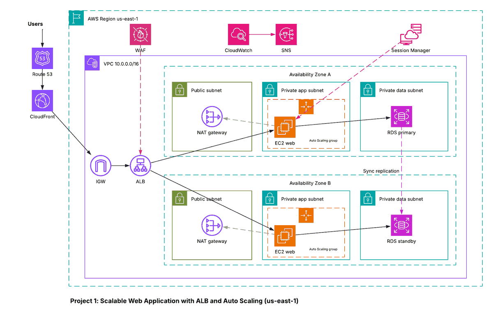

# Project 1 - Scalable Web Application with ALB and Auto Scaling (EC2)

## Architecture diagram

## Overview
A highly available, three-tier web application in `us-east-1`. Traffic enters through Route 53 and CloudFront, is filtered by AWS WAF, and is spread across EC2 instances in two Availability Zones by an Application Load Balancer. Instances scale automatically with demand, and the database runs Multi-AZ.

## Request flow
1. A user resolves the domain through Route 53 (alias record with health checks).
2. CloudFront serves cached content and forwards the rest to the ALB.
3. AWS WAF (OWASP managed rules) inspects requests at the ALB.
4. The ALB in the public subnets sends traffic to EC2 instances in the private app subnets.
5. Instances read and write to Amazon RDS (Multi-AZ) in the private data subnets.
6. Instances reach the internet for updates only through the NAT Gateway.

## Services and why they are used
| Service | Role | Why |
|---|---|---|
| VPC, 2 AZs, public/private subnets | Network | Isolates tiers; surviving the loss of one AZ |
| Security groups and NACLs | Network security | Least-privilege traffic between tiers (ALB -> app -> DB only) |
| Internet Gateway and NAT Gateway | Connectivity | Public entry for the ALB; outbound-only internet for private instances |
| EC2 + Launch Template | Compute | Repeatable instance configuration |
| Auto Scaling Group (target tracking) | Elasticity | Scales on a metric such as average CPU |
| Application Load Balancer | Load balancing | Health checks and distribution across AZs |
| AWS WAF (OWASP rules) | Web protection | Blocks common attacks such as SQL injection and XSS |
| CloudFront | CDN | Lower latency and less load on the origin |
| RDS Multi-AZ | Database | Automatic failover to a standby in the second AZ |
| Route 53 (alias + health checks) | DNS | Routes users to healthy endpoints |
| Systems Manager Session Manager | Admin access | Shell access without SSH keys or open port 22 |
| CloudWatch + SNS | Monitoring | Alarms drive scaling and notify the team |

## Security
- No instance has a public IP; administration goes through Session Manager.
- Security groups reference each other (ALB SG -> app SG -> DB SG).
- WAF sits in front of the ALB; the database is only reachable from the app tier.

## Reliability and scaling
- Two AZs for every tier; RDS standby for failover.
- Auto Scaling replaces unhealthy instances and adds capacity on demand.

## How to deploy (outline)
Create the VPC and subnets, security groups, launch template, target group and ALB, Auto Scaling group with a target tracking policy, RDS Multi-AZ, WAF web ACL, CloudFront distribution and Route 53 records, then CloudWatch alarms to SNS.
