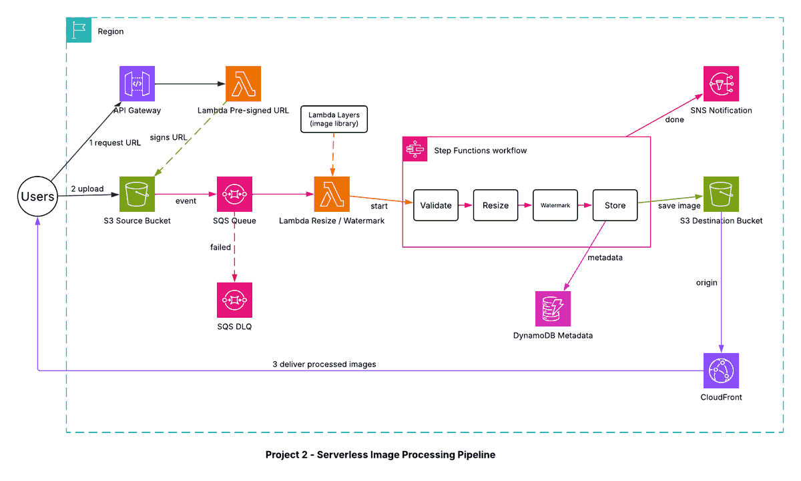

# Project 2 - Serverless Image Processing Pipeline with S3, SQS and Lambda

## Architecture diagram

## Overview
An event-driven pipeline that accepts image uploads, processes them (validate, resize, watermark), stores the result and its metadata, and serves the images globally. There are no servers to manage.

## Flow
1. The client calls API Gateway; a Lambda function returns a pre-signed S3 URL.
2. The client uploads the image directly to the source S3 bucket.
3. The S3 event notification sends a message to an SQS queue (failed messages move to a dead-letter queue).
4. A Lambda function reads the queue and starts an AWS Step Functions workflow.
5. The workflow runs: Validate -> Resize -> Watermark -> Store.
6. The processed image goes to the destination bucket, metadata goes to DynamoDB, and SNS sends a completion notification.
7. CloudFront serves the processed images from the destination bucket.

## Services and why they are used
| Service | Role | Why |
|---|---|---|
| API Gateway + Lambda | Pre-signed URL endpoint | Uploads go straight to S3, not through Lambda |
| S3 (source and destination) | Storage | Bucket policies, lifecycle rules and event notifications |
| SQS + DLQ | Buffering | Absorbs bursts; retries; failed messages kept for inspection |
| Lambda (with Layers) | Processing | Image library shared through a Layer |
| Step Functions | Orchestration | Visible, retryable multi-step workflow |
| DynamoDB | Metadata | Fast key-value lookups by image ID |
| CloudFront | Delivery | Caching and low latency for end users |
| SNS | Notification | Tells users or systems that processing finished |

## Security and reliability
- Pre-signed URLs expire and are scoped to one object.
- Buckets are private; CloudFront reads the destination bucket only.
- The DLQ prevents poison messages from blocking the queue.
- Lifecycle rules move or expire old source images to control cost.
