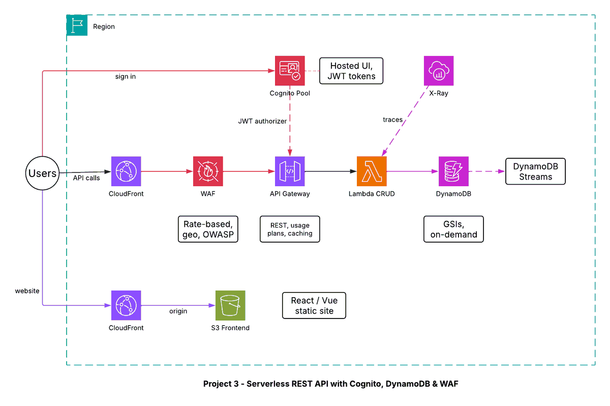

# Project 3 - Serverless REST API with Cognito Auth, DynamoDB and WAF

## Architecture diagram

## Overview
A secured, serverless CRUD API with user sign-in, plus a static React/Vue frontend. Requests pass through CloudFront and AWS WAF, are authenticated by a Cognito JWT authorizer, and are handled by Lambda against DynamoDB.

## Flow
1. The user opens the static site (CloudFront -> S3).
2. The user signs in through the Cognito hosted UI and receives JWT tokens.
3. The frontend calls the API through CloudFront.
4. AWS WAF applies a rate-based rule, geo restrictions and OWASP managed rules.
5. API Gateway validates the JWT with the Cognito authorizer, applies usage plans and caching.
6. Lambda performs create, read, update and delete operations in DynamoDB.
7. X-Ray traces requests; DynamoDB Streams capture item changes.

## Services and why they are used
| Service | Role | Why |
|---|---|---|
| API Gateway (REST) | API front door | Authorizers, usage plans, caching |
| Cognito User Pool | Authentication | Hosted UI and JWT tokens without custom auth code |
| Lambda | Business logic | Pay per request, scales automatically |
| DynamoDB (GSIs, on-demand) | Data store | Alternate query patterns through GSIs; no capacity planning |
| DynamoDB Streams | Change capture | Triggers downstream processing |
| AWS WAF | Protection | Rate limiting, geo rules, OWASP rules |
| CloudFront | Edge | Fronts both the API and the static site |
| X-Ray | Tracing | Finds slow or failing calls |
| S3 | Frontend hosting | Static React/Vue build |

## Security
- Every API route requires a valid Cognito token.
- WAF limits abusive clients before they reach API Gateway.
- Lambda roles are limited to the table they use.
