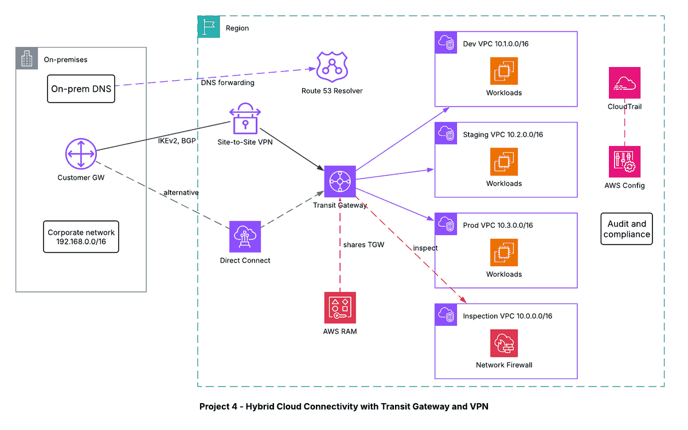

# Project 4 - Hybrid Cloud Connectivity with Transit Gateway and Site-to-Site VPN

## Architecture diagram

## Overview
A hub-and-spoke network that connects an on-premises data center to several VPCs through one AWS Transit Gateway. Traffic between VPCs can be inspected centrally by AWS Network Firewall.

## Design
- Dev, Staging and Prod VPCs use non-overlapping CIDRs (10.1.0.0/16, 10.2.0.0/16, 10.3.0.0/16) and attach to the Transit Gateway.
- An Inspection VPC (10.0.0.0/16) holds AWS Network Firewall; spoke traffic is routed there through Transit Gateway route tables.
- The on-premises network connects with a Site-to-Site VPN (IKEv2, BGP, private ASN) to the Transit Gateway. AWS Direct Connect is the alternative for dedicated, predictable bandwidth.
- Route 53 Resolver inbound and outbound endpoints let on-premises and AWS resolve each other's DNS names.
- AWS RAM shares the Transit Gateway with other accounts.
- CloudTrail and AWS Config record API activity and configuration changes.

## Services and why they are used
| Service | Why |
|---|---|
| Transit Gateway (separate route tables) | One hub instead of many VPC peerings; separate Dev, Staging and Prod routing |
| Site-to-Site VPN with BGP | Encrypted tunnels with dynamic route exchange |
| Direct Connect (alternative) | Private, consistent connectivity |
| Route 53 Resolver endpoints | Hybrid DNS resolution |
| AWS RAM | Share the Transit Gateway across accounts |
| AWS Network Firewall | Centralized traffic inspection |
| CloudTrail and Config | Audit and compliance |

## Notes
CIDR blocks must never overlap, or Transit Gateway cannot route between the networks.
