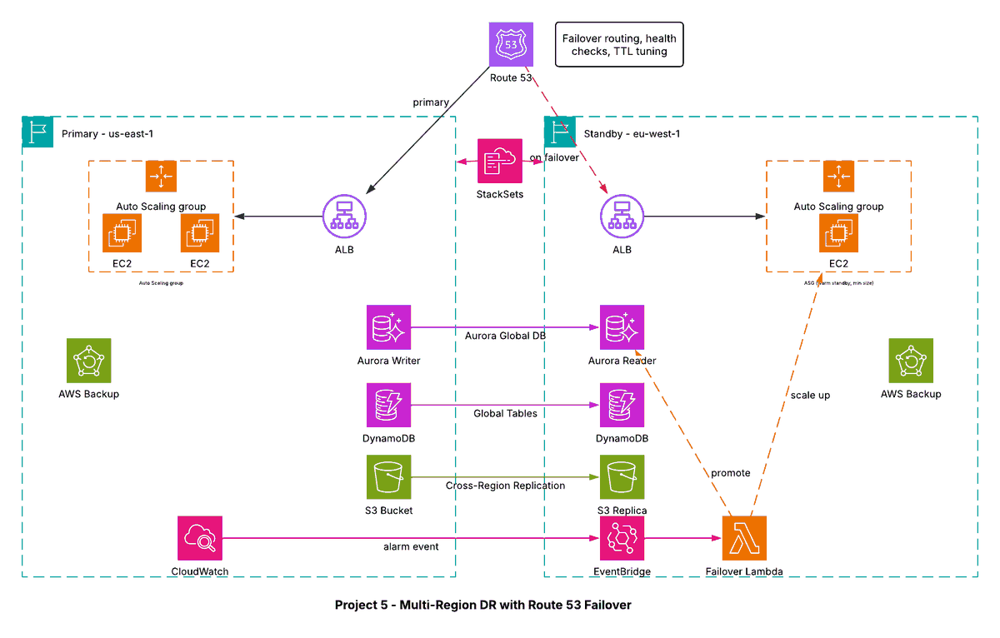

# Project 5 - Multi-Region Disaster Recovery with Route 53 Failover

## Architecture diagram

## Overview
A warm standby disaster recovery design. `us-east-1` is the primary Region and `eu-west-1` is a scaled-down standby that is always running, so it can take over quickly.

## How failover works
1. Route 53 failover routing sends users to the primary while its health check passes (low TTL speeds up switching).
2. If the primary fails, CloudWatch alarms raise an event on EventBridge.
3. EventBridge triggers a failover Lambda function that promotes the Aurora secondary cluster and scales up the standby Auto Scaling group.
4. Route 53 starts answering with the standby endpoint.

## Data replication
| Data | Mechanism |
|---|---|
| Relational data | Aurora Global Database (secondary Region reader) |
| Key-value data | DynamoDB Global Tables |
| Objects | S3 Cross-Region Replication |
| Backups | AWS Backup |
| Infrastructure | CloudFormation StackSets deploy the same stacks to both Regions |

## DR strategy comparison
| Strategy | RTO / RPO | Cost |
|---|---|---|
| Backup and restore | Hours / hours | Lowest |
| Pilot light | Tens of minutes / minutes | Low |
| Warm standby (this project) | Minutes / seconds to minutes | Medium |
| Multi-site active-active | Near zero / near zero | Highest |

Warm standby was chosen because it recovers in minutes without paying for a full second environment.
