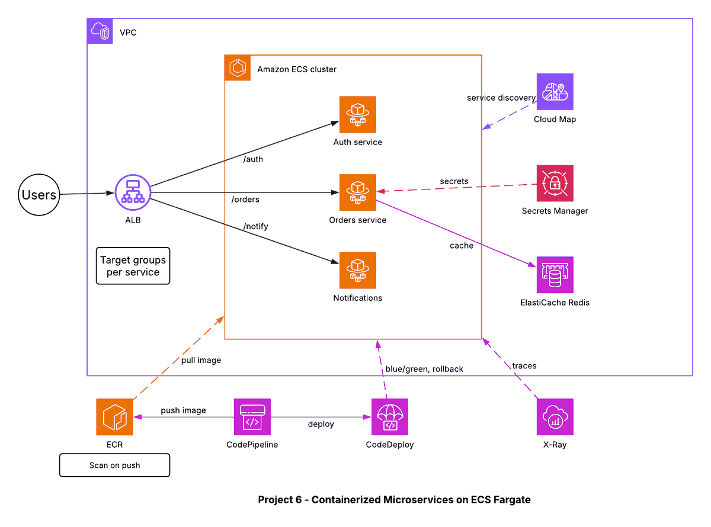

# Project 6 - Containerized Microservices with ECS Fargate and Service Discovery

## Architecture diagram

## Overview
Three microservices (Auth, Orders, Notifications) run as containers on Amazon ECS with the Fargate launch type, so there are no servers to manage. An Application Load Balancer routes requests by path, and AWS Cloud Map lets services find each other by name.

## Flow
1. Users call the ALB; path rules send `/auth`, `/orders` and `/notify` to separate target groups.
2. Each target group points to one Fargate service.
3. Services discover each other through Cloud Map (private DNS names).
4. Secrets (for example database credentials) are read from AWS Secrets Manager.
5. The Orders service uses ElastiCache Redis as a cache.
6. X-Ray traces calls across services.

## CI/CD
CodePipeline builds the image and pushes it to Amazon ECR (image scanning on push is enabled). CodeDeploy performs blue/green deployments on ECS and can roll back automatically if health checks fail.

## Services and why they are used
| Service | Why |
|---|---|
| ECS Fargate | Containers without managing EC2 |
| ECR (scan on push) | Private registry with vulnerability scanning |
| ALB + target groups | Path-based routing to each service |
| Cloud Map | Service discovery by name |
| Secrets Manager | Credentials kept out of images and code |
| ElastiCache Redis | Low-latency caching |
| CodePipeline + CodeDeploy | Automated, safe releases (blue/green and rollback) |
| X-Ray | Distributed tracing |
