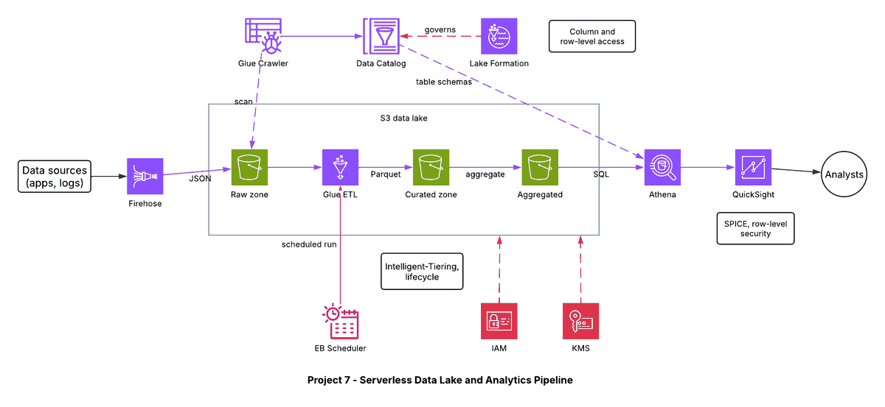

# Project 7 - Serverless Data Lake and Analytics Pipeline

## Architecture diagram

## Overview
A serverless pipeline that ingests raw data, converts it to an analytics-friendly format, governs access, and exposes it to SQL and dashboards.

## Flow
1. Data sources stream records into Amazon Data Firehose.
2. Firehose writes JSON to the raw zone of the S3 data lake.
3. A Glue crawler scans the data and registers tables in the Glue Data Catalog.
4. A scheduled Glue ETL job (started by EventBridge Scheduler) converts JSON to partitioned Parquet in the curated zone, and an aggregation step fills the aggregated zone.
5. Athena runs SQL on the catalog tables.
6. QuickSight (SPICE cache, row-level security) shows dashboards to analysts.
7. Lake Formation controls column-level and row-level access; IAM and KMS secure and encrypt the lake.

## Services and why they are used
| Service | Why |
|---|---|
| S3 (raw / curated / aggregated) | Cheap, durable storage; Intelligent-Tiering and lifecycle rules control cost |
| Data Firehose | Managed streaming delivery to S3 |
| Glue crawler, ETL, Data Catalog | Schema discovery and conversion to Parquet |
| Athena | Pay-per-query SQL, no cluster |
| Lake Formation | Fine-grained access control |
| QuickSight | Dashboards with SPICE and row-level security |
| EventBridge Scheduler | Time-based ETL runs |
| IAM and KMS | Permissions and encryption |

## Why Parquet
Columnar, compressed and partitioned data means Athena scans less data, so queries are faster and cheaper.
