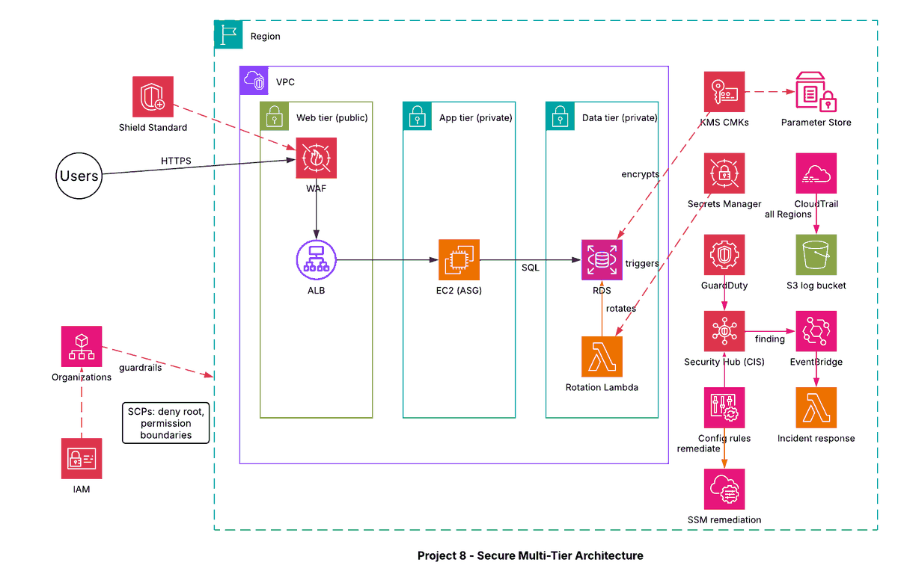

# Project 8 - Secure Multi-Tier Architecture with GuardDuty, KMS and Security Hub

## Architecture diagram

## Overview
A three-tier application (web, app, data) with layered security: protection at the edge, encryption everywhere, continuous threat detection, compliance checks with automatic remediation, and automated incident response.

## Layers
| Layer | Services |
|---|---|
| Edge protection | AWS WAF, Shield Standard |
| Network | Web tier in a public subnet; app and data tiers in private subnets |
| Encryption | KMS customer managed keys for S3, RDS, EBS and SSM Parameter Store |
| Secrets | Secrets Manager with automatic RDS credential rotation by Lambda |
| Detection | GuardDuty (threats), Security Hub (CIS benchmark and findings), CloudTrail (all Regions, log file validation) |
| Compliance | AWS Config rules with Systems Manager Automation for remediation |
| Governance | AWS Organizations SCPs (deny root actions), IAM permission boundaries |
| Response | EventBridge rule on findings triggers a Lambda incident response function |

## Flow
Users -> WAF -> ALB (web tier) -> EC2 (app tier) -> RDS (data tier). GuardDuty and Config send findings to Security Hub; EventBridge reacts to high-severity findings and starts the Lambda that isolates the resource and notifies the team.
